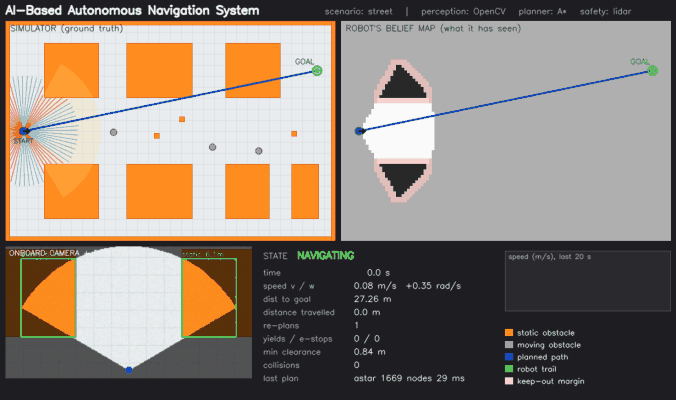
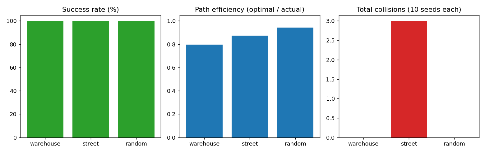
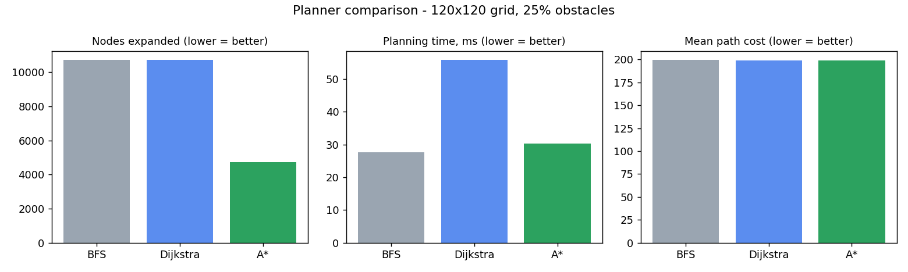
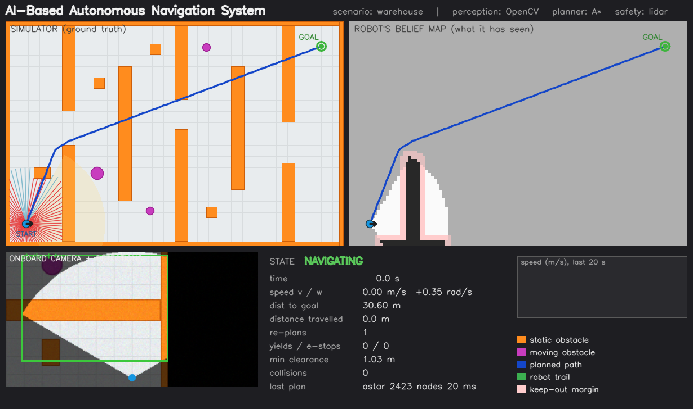
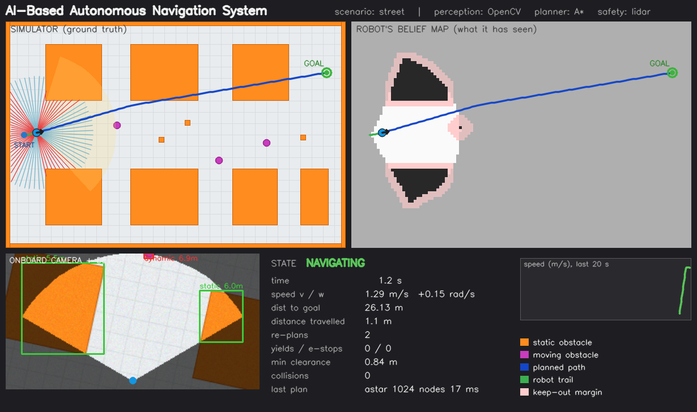
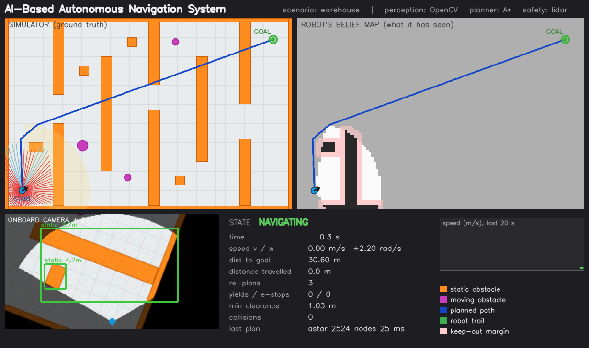
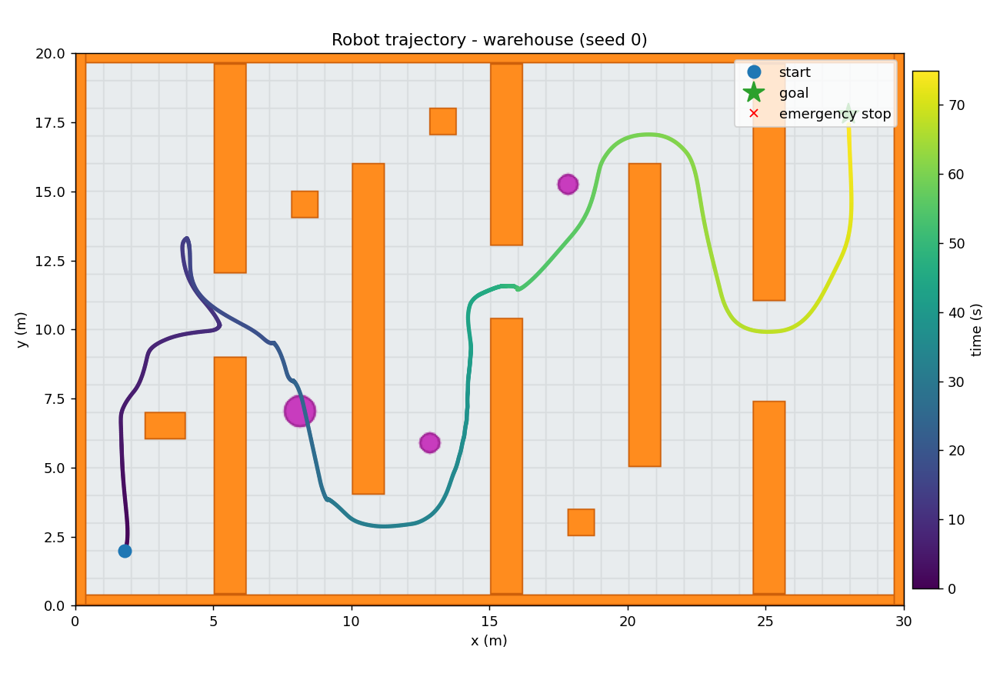
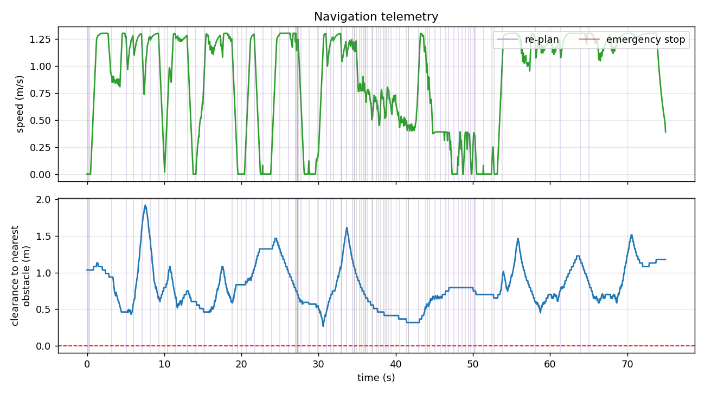

# 🤖 AI-Based Autonomous Navigation System

**A robot that has never seen its environment drives itself to a goal: perceiving obstacles with computer vision, building a map, planning with A\*, predicting where moving people will be, and stopping safely - all in a virtual simulation, no hardware needed.**


<sub>Street scenario. Left: simulator (ground truth). Right: what the robot actually knows. Bottom: onboard camera with detections, plus live telemetry.</sub>

[]() []() []() []()

---

## Overview

The robot starts with an **empty map**. It sees only through a noisy simulated camera and a 360° range sensor. As it drives it must discover obstacles, plan around them, dodge moving obstacles, and keep itself safe. This is the same perception → planning → control loop used (at far larger scale) in delivery robots, warehouse AMRs and self-driving cars.

## Problem statement

> Given a start, a goal and an **unknown, partly moving** environment, move a robot to the goal efficiently, without collisions, using only onboard sensing.

## Industry relevance

Autonomous navigation is the core problem in warehouse automation (AMRs), delivery robots, autonomous vehicles, inspection robots and drones. Companies in these areas (e.g. Waymo, NVIDIA, Tesla, Amazon Robotics, Tata Motors' autonomy teams, and many robotics start-ups) work on much more advanced versions of the same pipeline. This project is a small, honest, working model of that pipeline - not a production system.

## Features

| Stage | What is implemented |
|---|---|
| **Sensing** | Egocentric bird's-eye camera (120° FOV, 7 m, Gaussian noise) + 72-beam lidar (5 m, noise) |
| **Computer vision** | Blur → HSV segmentation → morphology → contours → classified detections (`static` / `dynamic`) with world positions |
| **Mapping** | Log-odds occupancy grid ("belief map") built only from what the camera has seen |
| **Planning** | A\* (8-connected, no corner cutting, octile heuristic), obstacle-clearance cost map, line-of-sight path smoothing. Dijkstra and BFS included for benchmarking |
| **Dynamic obstacles** | Tracking, velocity estimation, 3 s constant-velocity prediction with growing uncertainty, yield / dynamic-window evade |
| **Control** | Look-ahead path follower with speed scaling in turns, acceleration limits, actuator noise |
| **Safety** | Independent lidar layer: slow down, emergency stop, reverse-recovery, stuck watchdog |
| **Tooling** | Live dashboard, MP4/GIF export, auto-saved screenshots and plots, metrics JSON/CSV, batch evaluation, 21 unit/integration tests |

## Architecture

```
 Camera ─► ObstacleDetector ─► OccupancyBelief ─► cost map ─► A* ─► smoothed path ─┐
   │              │                                                                  ▼
   │              └──► Tracker + predictor ───────────────► PathFollower ─► (v, w) ─► yield/evade ─► lidar safety ─► Robot
 Lidar ───────────────────────────────────────────────────────────────────────────────────────────────▲
```
Full diagram, data flow and design decisions: [`docs/ARCHITECTURE.md`](docs/ARCHITECTURE.md)

## Folder structure

```
AI-Autonomous-Navigation-System/
├── main.py                  # command-line entry point
├── requirements.txt         # numpy, opencv-python, matplotlib, Pillow
├── src/autonav/
│   ├── config.py            # all tunable parameters
│   ├── geometry.py          # coordinate frames, Bresenham, kernels
│   ├── world.py             # ground-truth world, collisions, ray-casting
│   ├── scenarios.py         # warehouse | street | random
│   ├── robot.py             # unicycle kinematics
│   ├── sensors.py           # Camera, Lidar
│   ├── perception.py        # ObstacleDetector, OccupancyBelief
│   ├── planner.py           # A*, Dijkstra, BFS, smoothing
│   ├── avoidance.py         # tracking, prediction, yield/evade
│   ├── controller.py        # look-ahead path follower
│   ├── navigator.py         # state machine + safety layer
│   ├── simulation.py        # main loop, metrics, video/GIF
│   ├── visualizer.py        # dashboard
│   └── reporting.py         # matplotlib plots
├── scripts/                 # evaluate.py, benchmark_planners.py
├── tests/                   # 21 unit + integration tests
├── docs/                    # architecture, GitHub guide, career kit, roadmap, troubleshooting
├── hardware/                # optional Raspberry Pi stub (untested) + wiring fixes
├── images/  videos/         # demo assets used in this README
└── outputs/                 # generated runs (git-ignored)
```

## Installation

**Python 3.10 – 3.12 recommended.**

Windows (PowerShell / cmd):
```bat
py -3.11 -m venv .venv
.venv\Scripts\activate
python -m pip install --upgrade pip
pip install -r requirements.txt
python -c "import cv2, numpy; print('OpenCV', cv2.__version__, '| NumPy', numpy.__version__)"
```
macOS / Linux:
```bash
python3 -m venv .venv
source .venv/bin/activate
python -m pip install --upgrade pip
pip install -r requirements.txt
python -c "import cv2, numpy; print('OpenCV', cv2.__version__, '| NumPy', numpy.__version__)"
```
Verify: `python -m unittest discover -s tests` → `OK` (takes ~30 s).
Optional: install [ffmpeg](https://ffmpeg.org) for browser-friendly MP4s (the GIF works without it).

## How to run

```bash
python main.py                                    # warehouse, headless, saves everything to outputs/
python main.py --scenario street --show           # watch live in a window (q to quit)
python main.py --scenario street --seed 1 --video --gif
python main.py --scenario random --seed 7
python scripts/evaluate.py --seeds 10             # batch evaluation across scenarios
python scripts/benchmark_planners.py              # A* vs Dijkstra vs BFS
```
Each run writes to `outputs/<scenario>_seed<N>/`: `metrics.json`, `trajectory.csv`, `trajectory.png`, `telemetry.png`, screenshots (`01_environment.png` … `06_final_run.png`) and, with flags, `navigation_demo.mp4/.gif`.

Sample terminal output:
```
 RESULT : GOAL REACHED
 time 74.95s | path 65.41 m (perfect-map optimum 52.25 m, efficiency 0.799)
 re-plans 62 | emergency stops 0 | collisions 0 | min clearance 0.266 m
 planner: avg 9.69 ms, max 29.96 ms, avg 976.0 nodes
```

## Simulation workflow

1. A scenario builds the **ground-truth world** (hidden from the robot).
2. The robot starts with an **unknown map** and assumes unseen space is free.
3. Each 100 ms the camera frame is processed → detections → belief map update.
4. A\* plans on the inflated belief map; the path is smoothed.
5. When new obstacles block the path, it **re-plans**; moving obstacles are tracked and predicted.
6. The controller drives; the **lidar safety layer** can override.
7. Metrics and visuals are recorded.

## Results

30 simulated runs (10 random seeds × 3 scenarios; sensor noise and mover timing change with the seed). Full data: [`docs/results/evaluation.csv`](docs/results/evaluation.csv).

| Scenario | Goal reached | Collisions | Mean time | Path efficiency* | Mean re-plans | Median min clearance |
|---|---|---|---|---|---|---|
| warehouse (aisles + forklift + 2 workers) | 10 / 10 | **0** | 71.0 s | 0.80 | 55 | 0.27 m |
| street (blocks + 3 crossing pedestrians) | 10 / 10 | **3 events in 2 runs** | 36.4 s | 0.87 | 36 | 0.33 m |
| random clutter (+3 movers) | 10 / 10 | **0** | 31.6 s | 0.94 | 18 | 0.44 m |

\*Optimal path length with a *perfect* map ÷ distance actually driven. A robot that must discover the map can't reach 1.0.
Planning averages **8.6 ms** (max 38 ms); the simulation runs ~7× faster than real time on one CPU core.

**Honest reading:** 28 of 30 runs were collision-free. The two failing runs are in the street scenario, where pedestrians reverse direction abruptly in the road; a constant-velocity predictor can't anticipate that (see *Limitations*).




A\* and Dijkstra return the same optimal cost; A\* expands about **56 % fewer nodes** (4 721 vs 10 713 on 120×120 grids with 25 % obstacles). BFS ignores step cost, so it is not optimal.

## Screenshots

| | |
|---|---|
|  **Simulation start** |  **Obstacle detection** (boxes, classes, distances) |
|  **A\* path** |  **Re-planning** around newly discovered obstacles |
|  **Trajectory** |  **Telemetry** (speed, clearance, events) |

Full video: [`videos/navigation_demo_warehouse.mp4`](videos/navigation_demo_warehouse.mp4)

## Limitations (what this is *not*)

* **Perfect localisation** - the robot knows its pose. Real robots need SLAM/odometry fusion.
* **Detection is colour-based**, so it only works in this simulator. The `ObstacleDetector` interface is designed so a YOLO model can replace it.
* **Constant-velocity prediction** fails when pedestrians turn around suddenly - the cause of the residual street collisions.
* The camera is a simulated bird's-eye view; real cameras need inverse perspective mapping or depth.
* 2D world, circular robot. No dynamics beyond acceleration limits.
* "AI" here means classical AI (heuristic search, probabilistic mapping, state estimation) plus computer vision - there is no trained neural network yet.

## Future improvements

YOLO detector · localisation noise + EKF · ROS 2 node (`/scan`, `/cmd_vel`) · Gazebo/CARLA · RL local planner · multi-robot · drone (3D) version. Details and how-to: [`docs/ROADMAP.md`](docs/ROADMAP.md)

## What I learned

* Structuring a robotics stack (sense → perceive → plan → act) and keeping the robot's *belief* separate from ground truth
* A\* internals: admissible heuristics, cost fields, corner-cutting, path smoothing
* Probabilistic occupancy mapping, and why re-planning is essential with partial observability
* Layered safety design, and evaluating with metrics across seeds instead of one lucky run
* Debugging by replaying failures (several real bugs are documented in `docs/TROUBLESHOOTING.md`)

## Author

**<Your Name>** - <your degree / college>  
[LinkedIn](https://linkedin.com/in/your-id) · [GitHub](https://github.com/your-username) · your.email@example.com

Licensed under MIT.
